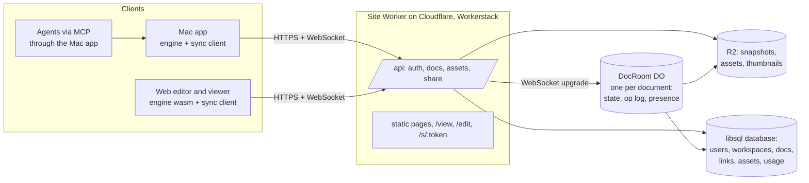

# Cloud design: accounts, cloud documents, share links, multiplayer

Status: **approved, November 2026; M1 in progress.** The decisions taken on the proposal
are listed under [Decisions](#decisions); §9 lists what is still open.

This page describes how Agentic Design gets:

- user accounts on the website;
- documents that live in the cloud and sync between the Mac app, the web editor and other
  devices;
- share links that anyone can open to view, also on a phone and as an installed web app;
- realtime editing of one file by several people and agents at once, with cursors, as in
  Figma.

It builds on what exists:

- the `.pen` engine, shared by the Mac app and the browser viewer ([architecture.md](architecture.md));
- agent cursors and the control socket's `presence` request (decision #35);
- the site, a Workerstack app on Cloudflare Workers hosted by Bunderhost ([site/README.md](../site/README.md)).

## Summary

| Question | Answer |
| --- | --- |
| Document types | Local `.pen` files stay exactly as they are. A new **cloud document** is stored on the server, which is the source of truth; it has version history, and the app keeps an offline copy. Upload, download and export convert between them. |
| Sync model | **Server-ordered operations, last writer wins per property** (Figma's model). One Durable Object per document orders every edit with a sequence number. Clients apply their own edits at once and reconcile with the server's order. No CRDT. |
| Fidelity | Values stay raw JSON text, and property order is kept. The server serializes with the engine's own `.pen` writer compiled to WebAssembly, so an exported cloud document is byte-identical to the app saving the same state. |
| Backend | Workerstack on Cloudflare through Bunderhost: Better Auth (email, Google, GitHub), the libsql database for accounts and metadata, R2 for snapshots and assets, and a `DocRoom` Durable Object per document for operations, presence and the recent op log. |
| Missing in the platform | App-defined Durable Object classes and WebSocket routing to them. An R2 binding rendered by Bunderhost: app files are on Tigris (S3) today, which works meanwhile. A cookieless origin for user content. |
| Sharing | Links grant view, then comment (M4), then edit. Visibility is private, anyone with the link, or public. Links can be revoked and can expire. Each link has an OG preview, an embed and rate limits. |
| Mobile | The WebGPU viewer works on iOS 26 and on most Android phones with Chrome. Without WebGPU, the share page shows frame images rendered by the client that saved the document. A WebGL2 engine backend comes later if the numbers call for it. |
| Pricing | Editing local files in the Mac app is free, and so is viewing on the web: share links and the viewer. Cloud documents are the paid tier: sync, editing cloud documents on the web, realtime. M1 is free. |
| Milestones | **M1**: accounts, sharing a file by link, mobile viewer. **M2**: cloud docs synced across one user's devices. **M3**: realtime multiplayer for people and agents. **M4**: comments. |
| Cost | Close to zero within the account's included usage at launch. Durable Object duration dominates as usage grows: about $0.006 per hour that a room with live cursors is open. |

## Decisions

Taken when the proposal was approved (November 2026).

**By the owner of the project:**

1. **Model** as proposed: server-ordered operations, last writer wins per property, a
   `DocRoom` Durable Object per document.
2. **Pricing.**
   - Free: editing local `.pen` files in the Mac app, and viewing on the web (share links,
     the viewer, the mobile viewer and the PWA).
   - Paid: cloud documents, from M2 on. That covers sync, editing cloud documents on the
     web, version history and realtime.
   - M1 is entirely free. There are no payments in M1. The billing method is decided when
     M2 is near.
   - From day one, every workspace carries a plan and its entitlements (§3.7). The
     server checks entitlements, never the plan name, so prices can change without code
     changes.
3. **Sync** covers cloud documents only. Local `.pen` files stay local. Moving one to the
   cloud is an explicit action ("Upload to cloud"), and the local file stays as it was.
4. **Teams** arrive with realtime in M3. M1 and M2 use personal workspaces only. The data
   model has workspaces and members from the start, so teams add no migration of
   ownership.

**Recommendations of this document, taken as decisions:**

5. **User content is served from the site's own domain** (reverses the proposal of a
   separate domain; owner's decision). Files are reachable only through access checks: the
   owner's workspace, an explicit share, or a share link. What may be uploaded is narrow:
   a `.pen` that passes the server's check, and images, fonts and libraries whose bytes
   match their declared type. HTML is never accepted. Every user file is sent with
   `nosniff`, `Content-Security-Policy: default-src 'none'; sandbox` and
   `Cross-Origin-Resource-Policy: same-site`, so a file opened directly runs no script
   with the site's cookies. From M2 the `.pen` check is the engine's own parser (§2), the
   same code that renders previews and history.
6. **Data region: not pinned for now** (reverses the EU proposal; owner's decision).
   Object storage uses the platform's default (Tigris, global); Durable Objects and the
   database follow the platform's defaults. Pinning a region is revisited later, together
   with the GDPR paperwork (§7).
7. **Edit links require sign-in** (M3). There is no anonymous editing. View links never
   need an account.
8. **History:** automatic versions are kept for 30 days. Named versions are kept as long
   as the document exists. Paid plans may raise the automatic window later.
9. **Agents' rights:** agents acting for a person may edit any cloud document that person
   can edit. The owner can turn agent edits off per document or per workspace. Agents
   never manage links, members, roles, deletion or exports (§7).
10. **Self-hosting** is not a product. The server code stays open in this MIT repository,
    with no support for running it elsewhere until M4 is done.
11. **pen.dev:** a byte-stable `.pen` download is the bridge. Cloud documents are not
    reachable from pen.dev directly.
12. **Public profiles and a gallery** come after M4. Public visibility exists in M1 (§4),
    but there is no listing yet.
13. **Free limits in M1** (shared files only): 1 GB of storage per account, 50 MB per
    `.pen`, 25 MB per asset, 100 shared files, and views rate-limited per link and per IP
    (§3.6).

---

## 1. Document types

### Local `.pen` (unchanged)

A `.pen` file on disk with `images/`, `fonts/` and libraries next to it, as today. It is
saved by autosave, undone by snapshots and has no history. Agents reach it through MCP. A
local file never talks to the server, except when the user uploads it.

### Cloud document (new)

A document whose master copy is on the server.

- **Identity.** A document id (`doc_…`, a TypeID). It is not a path. The document belongs to
  a project, and the project belongs to a workspace (§3.2).
- **State.** The server holds the current state: header properties, nodes and their
  properties, the parent and sort key of each node, and an asset manifest. It also holds an
  ordered log of operations. Each operation gets the next **sequence number** (`seq`) of the
  document.
- **History.** The server writes a checkpoint after a pause in editing, after every 500
  operations, when the last editor leaves, and when a user names a version. A checkpoint is
  a full `.pen` snapshot in R2. Any version can be viewed, downloaded, restored as the new
  head, or copied as a new document. The operation log between checkpoints is kept for 7
  days (§3.3).
- **Offline cache.** The Mac app keeps
  `~/Library/Application Support/Agentic Design/cloud/<docId>/` with `doc.pen` (the state at
  the last known `seq`), `images/`, `fonts/`, `libraries/` and `pending.jsonl` (edits not
  yet acknowledged). The folder is laid out like a local document, so the engine opens it as
  one and relative image and font paths resolve unchanged. The web editor keeps the same
  layout in OPFS (below).
- **Agents.** MCP works on cloud documents as on local ones (§6.4). Every edit is
  attributed to a user, and to an agent when an agent made it.

### Conversions

| From → to | What happens |
| --- | --- |
| Local → cloud ("Upload to cloud", "Share") | The client sends the `.pen` and every file it references, then opens the new cloud document in place of the local tab. The local file is left as it was. It is not linked to the cloud document and is not deleted, so there are never two masters of one file. |
| Cloud → local ("Download .pen", "Export") | The server writes the head, or a chosen version, as `doc.pen` with `images/`, `fonts/` and `libraries/`, in a zip on the web or a folder on the Mac. The download is a plain local document with no link back. |
| Cloud → cloud ("Duplicate", "Copy version as new") | The server copies the snapshot and the manifest. Assets are shared by content hash and not copied. |

What happens to files the document refers to, on upload:

- **Images.** Each image file is hashed (SHA-256) and uploaded once per workspace. In the
  document it keeps its relative path (`./images/photo.png`). The asset manifest maps that
  path to the hash. In cloud documents the app names new images `<name>-<hash8>.<ext>`, so
  that two people dropping `image.png` at the same time cannot overwrite each other's file.
  An absolute path to a local file, which an agent's `url` can be, is copied in as an image.
- **Fonts.** Fonts listed in the header's `fonts` are uploaded like images. The uploader
  also lists the families the document uses but does not embed: the Mac app finds those
  among the installed fonts, while the web draws them with Noto Sans. It offers to add them
  with `add_fonts`, and warns that the user must be allowed to share a commercial font.
  Exports already ship only openly licensed fonts (decision #48), and cloud documents
  follow the same rule when a font is shared through a public link.
- **Libraries** (`imports`: alias → relative path to another `.pen`). Each library is
  uploaded as a cloud document of its own in the same project, unless a document with the
  same content hash is already there. The manifest maps the import's path to that
  document. The `.pen` text keeps the alias and the relative path, so a download writes the
  library files at the same relative paths and the result opens in the Mac app and in
  pen.dev as before. A library that is missing on disk stays a missing reference, and the
  viewer reports it as it does today.
- **Files outside the document's folder** (`../shared/logo.png`) are uploaded, and the
  manifest keeps their original relative path. A download writes them under the
  download's root, so its paths still resolve.

---

## 2. Sync and collaboration model

### Requirements

1. Realtime multiplayer: about 2–20 editors and agents in one document, and up to about 100
   viewers, with cursors and changes arriving within about 100 ms.
2. Offline: the Mac app keeps editing a cloud document without a network for hours or
   days. The edits merge when it reconnects.
3. Agents: an MCP `batch` is all or nothing (decision #31). It must stay atomic for
   everyone and be one undo step for the agent.
4. `.pen` fidelity: unknown keys survive, and an export is byte-stable.
5. It must fit the engine: a flat node array with raw JSON props in file order, and undo
   snapshots taken once per user step (architecture: Document model).
6. Server checks: roles (viewer, commenter, editor), quotas, and tree invariants (no
   cycles, no orphans).

### Options

**A. CRDT** (Yjs or Automerge over a `.pen`-shaped tree: a map per node, a map of props).
Each client holds a replica, and any two replicas converge after exchanging updates, with
no server in the middle.

- Offline merge is its strength, and it works peer to peer.
- **Moves are the weak point.** Yjs and Automerge have no tree move. A move is a delete and
  a re-insert, so two people moving the same layer at once can duplicate it, and a
  reparent can form a cycle that no replica can refuse. A design tool reparents all the
  time: grouping, framing, dragging into a frame.
- **The server cannot say no.** A CRDT accepts every update, so roles, quotas and
  invariants need a server that decodes and checks updates anyway. Agent batches can be
  bundled in one transaction, but a batch cannot be refused as a whole after another
  replica has seen it.
- **Fit.** There is no Odin implementation. The engine would link `yrs` (Rust, C FFI) or
  Automerge's C core into the Mac app and into the wasm editor, a second toolchain and
  about 1 MB more wasm. Or JS would own the document beside the engine, which keeps its
  own model, so there would be two models to keep in sync.
- **Growth.** Deleted items stay as tombstones. History is in the CRDT, while the `.pen`
  stays the export.

**B. Server-ordered operations, last writer wins per property** (Figma's published
approach; OT-like only in that a server orders everything). The server holds the document.
Clients send small operations; the server checks each batch, gives it the next `seq` and
broadcasts it. Two writes to the same property resolve by server order. Clients show
their own edits at once, and while an edit is unacknowledged its value hides incoming
values for the same property.

- **Moves and invariants** are checked in one place. A cycle or a move into a deleted
  parent is refused, and only that batch is rolled back.
- **Agent batches** are one server transaction: all accepted or all refused.
- **Offline** edits are a queue replayed on reconnect. They merge per property, which is
  what designers expect: "my color, your position". Long offline sessions get a safety net
  (below).
- **Fit.** Operations map one to one onto `node_set_raw`, `node_unset` and the structural
  procedures. The sync client is Odin, shared by the Mac app and the wasm editor; the host
  only moves bytes.
- **Text.** Two people typing in the same text layer at the same moment: the last commit
  wins. Figma does the same, and a soft lock ("Anna is editing this text") makes it rare.

**C. File-level sync with conflict copies** (Dropbox-style). The whole `.pen` is uploaded
on save. If the server changed since the client's base version, the client keeps both, as
"name (conflict copy)".

- It is simple and fine for one person on several devices.
- No realtime, no cursors, and no merge: two editors make a fork every time.

| Need | A. CRDT | B. Server ops, LWW per property | C. File sync |
| --- | --- | --- | --- |
| Realtime multiplayer with cursors | ✓ | ✓ | — |
| Offline edits merge without a server | ✓ | — | — |
| Offline edits merge on reconnect | ✓ | ✓ | — |
| Safe concurrent moves and reparents | — | ✓ | ✓ |
| Server can refuse an edit (roles, invariants) | — | ✓ | ✓ |
| Agent batch atomic for everyone | — | ✓ | ✓ |
| Native in Odin, one model in the engine | — | ✓ | ✓ |
| Byte-stable `.pen` export | — | ✓ | ✓ |
| Small to build | — | — | ✓ |

**Recommendation: B.** It is the only option that gives realtime, refusable atomic batches
and safe moves at once, and it fits the engine's model with no second document model. C
remains the escape hatch for long offline sessions (below). A CRDT could later carry the
content of a single text layer if simultaneous typing in one text layer turns out to
matter. That is a per-property upgrade, not a change of model.

### The operation model

The document state on the server and in each client:

- **Header.** Key → raw JSON, in `.pen` header order (pen-format.md: `version`, `themes`,
  `variables`, then alphabetical).
- **Nodes.** For each `id`: `parent` (an id, or the canvas), `sort` (a fractional index
  string, ordering siblings), `slot` (`slot_of`, for slot content inside an instance), and
  `props`: an ordered list of (key, raw JSON). The node's `type` and `id` are props like
  any other, but `id` cannot change.
- **Assets.** A manifest: relative path → content hash and media type. It is not written
  into the `.pen`.

Operations:

```jsonc
{ "op": "set",    "node": "a1b2c", "key": "fill", "raw": "\"#FF0000\"" }   // raw JSON text, verbatim
{ "op": "unset",  "node": "a1b2c", "key": "effect" }
{ "op": "create", "node": "k9x2p", "parent": "a1b2c", "sort": "a0V", "slot": "",
  "props": [["type","\"frame\""], ["id","\"k9x2p\""], ["width","120"]] }
{ "op": "move",   "node": "k9x2p", "parent": "root", "sort": "a0Vh" }
{ "op": "delete", "node": "k9x2p" }                                         // and its subtree
{ "op": "hset",   "key": "variables/color-surface", "raw": "{…}" }          // header entry
{ "op": "asset",  "path": "./images/photo-3fa1c2d0.png", "hash": "sha256:…", "type": "image/png" }
```

**Granularity.** Most keys are opaque values, last writer wins per (node, key). A few keys
hold maps or id lists that people edit at the same time, and these merge per entry:

| Key | Merged per |
| --- | --- |
| header `variables` | variable name |
| header `themes` | axis |
| header `imports` | alias |
| header `fonts` | entry (by `url`) |
| header `pages` | page (internal id) for name and order. A top-level node's page is a property of that node, so two people adding frames to a page never lose one. |
| node `descendants` | override path (`post-title`, `vote/count`) |
| node `metadata` | key, except `type` |

The `pages` header is rebuilt from these entries when the document is serialized. Which
order its `nodes` arrays take must match what the app writes; this is part of the
serializer contract below.

**Batches.** A client sends `{batch: id, base: seq, ops: […], agent?: {client, session}}`.
The server applies a batch in a single transaction, so it is accepted or refused whole. It
answers the sender with `ack {batch, seq}` or `nack {batch, reason}`, and broadcasts
`{seq, author, agent, ops}` to everyone else. An MCP `batch` is one batch. A drag is one
batch, sent on release. While it lasts, the moving layers' positions go out as transient
`preview` messages, at most 20 a second, which the room relays but never stores. Others
see the drag live, and the log holds one step.

**Rules the server enforces.**

- `set` or `unset` on a node that does not exist (deleted concurrently): ignored, and
  acknowledged. The edit was to something that is gone, as in Figma.
- `create` with an id that already exists: refused. Ids are unique per document and never
  rewritten by edits; copies and pastes get fresh ones (Dev). But `gen_id` makes five
  random characters, checked only against the local document, so two clients can clash.
  In cloud documents, clients mint a short session prefix plus a counter, or 10 or more
  random characters, never with `/` (it separates `descendants` paths). A refused create
  is renamed on the client and sent again. Files from other tools can hold duplicate ids;
  the upload renames the later copies and reports it.
- `move` that would make a cycle, or into a missing parent: refused. On a replay after
  offline editing, a create or move into a parent that was deleted meanwhile goes to the
  nearest live ancestor (tombstones keep the last parent for 30 days) and is reported to
  the user. Their work is not dropped.
- A role below editor: every operation refused. A comment-only role (M4) has its own
  message type, not ops.
- Limits: 1 MB per message, 10,000 ops per batch, 50 batches a second per connection, and
  the workspace quota (§3.6).

**Sibling order** uses fractional index strings, as Figma does. Inserting between two
siblings needs no renumbering. A random suffix per client breaks ties between concurrent
inserts at the same place. Uploading a file gives its children evenly spaced keys in file
order.

### Clients: optimistic apply and reconciliation

Each client keeps the server state at its last `seq` plus its own unacknowledged batches,
and draws the server state with those batches on top.

1. A local edit applies at once and joins the next outgoing batch. Each (node, key) it
   touches is marked **pending** with the batch id.
2. An incoming remote operation on a pending (node, key) is recorded in the server state
   but not shown, because the pending value will win: the client's batch comes later in
   the server's order. Every other remote operation applies at once.
3. On `ack`, the pending marks of that batch are cleared. On `nack`, the batch is undone
   locally and the user or agent is told why.
4. Structural operations follow the same rule per node, for parent and sort.

This is what makes Figma feel instant. No transformation of operations is needed, because
the server never reorders anything after acknowledging it.

### How the engine applies remote operations

Remote operations arrive on a network thread and are queued. The main thread applies them
between frames, as `process_requests` does with socket requests, so the document is never
touched from two threads.

- `set` → `node_set_raw` + `node_refresh`. `unset` → `node_unset`. Structural operations
  call the procedures the editor already uses, then `doc_bump`. Then `layout_invalidate`.
- Remote edits bypass `push_undo`. They are not the user's own steps.
- Layers that remote operations touched flash in the author's colour, with the machinery
  agents' cursors already use (decision #35).
- Remote operations are never applied during layout, because layout itself writes some
  props (below). They are applied before it, and the layout pass runs after them, as it
  does after `process_requests`.
- **Mid-gesture** (Dev's review):
  - A drag writes `x`/`y` every frame. Remote operations on the layers in `app.drag` /
    `move_roots` wait until release; then the drag's one batch wins by server order.
  - Text editing (`app.editing`) works on the content in place. A remote `content` for
    that layer waits until the edit is committed or cancelled, so the caret is never
    clobbered. If the remote value differs, the user is told that their commit replaced
    someone else's text.
  - A remote delete or reparent of the layer under a gesture cancels the gesture.
- **Producing operations: snapshot diffs, not a journal.** Not every write goes through
  `node_set*` / `node_unset`. About 11 sites write `n.props` directly (`outline_text`,
  `migrate_extension_props`, `inject_at`), and structural changes edit `doc.nodes` (Dev).
  But undo already takes, once per user step at `push_undo`, a `Snapshot` of per-node
  records keyed by a content hash, with structural sharing. Diffing two consecutive
  snapshots by record hash gives the changed, created and deleted nodes and the header
  record of the step. The step's prop-level operations (raw old and new) come from that
  diff, as decision #35's presence diff does per request. The baseline is the snapshot
  after the last remote operations and their layout, so remote changes never come back
  as local ones.
- **Derived props.** Layout writes some props itself: `fit_shapes` rewrites a shape's
  `padding` and `cornerRadius`, and `route_connectors` rewrites a connector's `geometry`,
  `x`, `y`, `width` and `height`. Every client would compute them, so they must not
  become people's edits. The step's author sends them flagged `derived`. The room stores
  them, so the server state and the export stay complete, but it does not broadcast them:
  every other client computes the same values from the same inputs. They never mark a key
  pending and never enter undo.
- **The web editor** compiles the app package itself (`src/`: tabs, undo, inspector,
  widgets) to WebAssembly, with the desktop-only files (socket, MCP, updater, macOS
  dialogs) replaced by stubs. The sync client therefore runs there unchanged. The page
  only owns the WebSocket and passes frames in and out (`sync_receive(bytes)`,
  `sync_take_outgoing()`). The Mac app does the same over `URLSessionWebSocketTask` (a
  small `net_darwin.odin` beside the other Cocoa files).
- **The web editor's storage**, agreed with the web side and being built now for local
  saving:
  - a `DocStore` interface (`list`, `open`, `save`, `putAsset`, `readAsset`, `rename`,
    `delete`) over `DocRef {provider, id, name}`;
  - two providers today: `opfs` (the default, every browser) and `local-fs` (File System
    Access, Chrome and Edge). Downloads are an export, not a provider;
  - engine roots `/opfs/<id>/` and `/fs/<handle>/`. Cloud adds a `cloud` provider and
    `/cloud/<id>/`;
  - the OPFS layout `docs/<id>/doc.pen`, `images/`, `fonts/`, `meta.json` (with `cloud:
    null` reserved for `{docId, serverSeq}`), which becomes a cloud document's offline
    cache unchanged;
  - one writer per document across tabs (Web Locks); other tabs go read-only through
    `BroadcastChannel`.

### Undo per user

Each client undoes only its own steps. Remote edits never enter its stack.

- An undo record is the diff of one step: (node, key, raw before, raw after) plus the
  structural changes, stored by `push_undo` beside the snapshot (Dev: a local change in
  `push_undo` and undo; the hard part is the per-user rule below, not the code).
- Undo sends the inverse as a new batch, but leaves out every key whose current value is
  no longer the one this step wrote, because someone else has changed it since. Undo
  never overwrites a collaborator's work. Redo works the same way in reverse. An undo of
  a delete re-creates the nodes with their ids, which tombstones allow.
- An agent's MCP `undo` undoes the agent's own last batch. The person's ⌘Z undoes the
  person's own steps, not the agent's. History shows an agent's batches under its name,
  so a person can also revert one of them there.
- Local `.pen` documents keep their whole-snapshot undo.

### Offline editing

- The Mac app appends outgoing batches to `pending.jsonl` before sending them, so an edit
  survives a crash or a quit while offline. On reconnect it replays them in order, with
  their original `base`.
- **Safety net.** If the client was offline for more than 24 hours, or other people
  changed more than 200 properties that it also changed, the app asks before merging:
  "Merge my offline changes" or "Keep my version as a copy". The copy is option C's
  conflict copy, created on the server from the client's local state.
- The web editor keeps the same queue in OPFS. A browser tab is offline only until it
  closes, unless the PWA is installed (§5).

### `.pen` fidelity and byte-stable export

The goal: exporting a cloud document gives exactly the bytes the Mac app writes when it
saves the same state. A file the app has saved survives upload and download byte for byte.

- **Values are never re-encoded.** Each prop's raw JSON text is stored and relayed
  verbatim, from the client's step diff through the server to every other client. Numbers
  keep their digits (`1.0` stays `1.0`) and unknown keys their exact form. JSON objects are never round-tripped
  through JavaScript in the Durable Object. Props are a list of pairs, because JavaScript
  objects reorder integer-like keys.
- **Order is kept.** A node's props keep their order: a new key is appended unless the
  engine's rank logic places it (a generated `id` goes where `prop_rank` puts it), and an
  existing key is replaced in place. The header follows pen-format.md. Children are
  serialized in sort-key order.
- **One serializer.** The Durable Object serializes with the engine itself: the document
  model and `pen.odin` (`doc_load`, `doc_serialize`; no GPU, fonts or layout) built as a
  small `pencore.wasm` (a few hundred KB) that the Durable Object loads. The same code
  validates uploads. Byte stability then holds by construction, not by two implementations
  kept in step. `doc_serialize` is a function of this state only with rules a second
  implementation would get wrong (Dev):
  - slot content is written inside the instance's `descendants` (`descendants_with_slots`),
    not as tree children;
  - nodes of imported libraries and instance ghosts are not written;
  - `pages_prune` runs before a save;
  - `migrate_extension_props` moves a node-level `strokeDashPattern` into `metadata`.
- **Test.** For every fixture of the round-trip suite (the private test repository):
  upload, apply random operation sequences on two simulated clients, and check that both
  clients and the server converge to the same state. Then download, and check that the
  bytes equal the Mac app's `doc_serialize` of the same state.
- Files written by pen.dev are normalised once on upload, exactly as opening and saving
  them in the Mac app normalises them. Nothing else changes.

---

## 3. Backend architecture



### 3.1 Auth

- **Better Auth** through Workerstack's `auth` option, on the site's own origin under
  `/api/auth/*`, with session cookies (`HttpOnly`, `Secure`, `SameSite=Lax`).
- **Methods.**
  - Email and password, with email verification and password reset, sent through
    Workerstack's SMTP email channel.
  - Google through Bunderhost's managed sign-in, so the site needs no Google OAuth client
    of its own.
  - GitHub through Bunderhost's managed sign-in as well. The broker supports Google and
    GitHub, each enabled per environment, so the site needs no OAuth app of its own.
  - No implicit linking of accounts by email; linking is done explicitly from settings.
- **The Mac app** signs in through the system browser, never an embedded web view: it
  opens `/auth/app?challenge=…&port=…` (PKCE), and the site redirects to
  `http://127.0.0.1:<port>/callback` with a one-time code. The app exchanges the code for
  a device session token (Better Auth's bearer sessions) and keeps it in the Keychain.
  Settings → Account lists devices and can revoke each one.
- **Personal access tokens** (later, for remote agents and scripts) are scoped to a
  workspace or to documents and to a role, stored hashed, and revocable.

### 3.2 Users, workspaces (teams) and projects

- A **workspace** is Better Auth's organization. Each user gets a personal workspace at
  sign-up, so every document has exactly one owner and one access path. A team is a
  workspace with more members (M3). Until then only personal workspaces exist.
- A workspace has a **plan** and **entitlements** (§3.7): whether it may hold cloud
  documents, its storage limit, history days, editors per document. M1 gives every
  workspace the free plan: shared files, no cloud documents.
- Members have roles: owner, admin, editor, viewer. Invitations go by email or by an
  invite link.
- A **project** is a folder of documents in a workspace. Documents are created and listed
  in projects. Moving a document between projects keeps its id and its links.
- **Document access** is the workspace role, raised by an explicit share to a person
  (`doc_member`) or by a share link (§4). Access is the highest role that applies.

### 3.3 The document store

**Object storage.** The decision is R2, and this page says "R2" for the app's bucket.
Today Bunderhost's Cloudflare target gives each app an S3 bucket on Tigris instead. It
sets `WORKERSTACK_S3_*` and a CORS rule, so Workerstack already presigns uploads straight
from the browser and redirects private downloads to presigned GETs. Workerstack prefers an
R2 binding when one exists, but Bunderhost does not render one yet (§3.8). Everything
below works on either. The same key layout and the same storage adapter are used; the
Durable Object reaches Tigris through the S3 API instead of a binding. Two differences
from R2: public reads of a Tigris bucket go through the Worker, and preview environments
fork the bucket.

Each place holds what it is good at:

| Data | Where | Why |
| --- | --- | --- |
| Live state and the recent op log (7 days) | `DocRoom` Durable Object, its SQLite storage | Single writer per document, transactions, next to the WebSockets |
| Checkpoints: full `.pen` snapshots, gzip | R2 `docs/<docId>/v/<seq>.pen.gz` | Cheap, immutable, cacheable at the edge, free egress |
| Thumbnails, OG image, frame previews | R2 `docs/<docId>/v/<seq>/thumb.png`, `og.png`, `frames/<id>.png` | Rendered by clients (§4.4) |
| Documents, versions, links, members, usage | libsql database (Workerstack, drizzle) | Queries across documents: dashboards, sharing, quotas |
| Assets | R2 `assets/<workspaceId>/<sha256>` | Content-addressed and deduplicated per workspace (§3.5) |

Loading a document:

1. The client calls `GET /api/docs/:id`. The Worker checks access and returns metadata,
   the latest checkpoint's URL and its `seq`.
2. The client fetches the checkpoint (an immutable URL, cached at the edge) and its assets.
3. The client opens `wss://…/api/rooms/:id?since=<seq>`. The room sends the operations
   after `seq`, then live traffic. A client whose `since` is older than the op log gets a
   fresh checkpoint URL instead.

The Durable Object writes behind: each batch is one row in `ops`, and the `nodes` table is
updated from memory every few seconds and at checkpoints. That keeps rows written, a
billed metric, near one per batch.

The room hibernates when nobody sends (WebSocket Hibernation API), so a quiet document
costs nothing. It sets an alarm to write a checkpoint after 30 s without edits.

### 3.4 Realtime and presence: `DocRoom`

- One Durable Object per document: `idFromName(docId)`. It accepts WebSockets from the
  Worker after the Worker has checked the session or link. The principal and the role
  travel in the socket's attachment, so the room never trusts a name or a role the client
  sends.
- **Messages.** `ops` / `ack` / `nack`, `presence`, `hello` (since, client, agent), `bye`,
  `kick` (link revoked or role lowered), `checkpoint` (a new version exists).
- **Presence.** Cursor position in document coordinates, selection ids, viewport, tool,
  and the "editing text" soft lock. Each entry has a kind: person or agent, with the
  agent's client and the user it acts for. Presence is relayed, never stored. Clients send
  it at most 10 times a second, and only while someone else is in the room. A person alone
  in a document sends no cursor traffic, so the room can sleep between edits.
- Agents' cursors: the Mac app already computes where each agent's cursor goes (decision
  #35). For a cloud document it also sends that position as a presence entry of kind
  agent, so everyone in the room sees "Claude (Kirill's)" move and flash.
- **Revocation.** When a link is revoked or a member removed, the Worker tells the room,
  which closes the affected sockets with `kick`.

### 3.5 Assets: images, fonts, libraries

- Content-addressed per workspace: `assets/<workspaceId>/<sha256>`. One upload serves
  every document and version in the workspace that uses the file. There is no
  deduplication across workspaces: it would let one account learn that another holds a
  given file.
- The upload flow: `POST /api/assets` with the hashes and sizes; the server answers which
  hashes it lacks; the client sends those, either to presigned R2 URLs or through the
  Worker in M1 (§3.8). The server checks the hash, the media type (PNG, JPEG, WebP, GIF,
  SVG kept as an image, TTF, OTF, WOFF, WOFF2) and the quota.
- Reads go through `GET /api/docs/:id/assets/:hash` (or a share link's equivalent). The
  hash must be in that document's manifest, so a known hash grants nothing by itself. The
  responses are immutable (`Cache-Control: public, max-age=31536000, immutable` for public
  links, `private` otherwise) and served from the user-content origin (§7).
- Libraries are cloud documents (§1). The manifest holds `path → libraryDocId`. A
  document opens its libraries at their head. In M3 an open document follows changes to
  its libraries live, as the Mac app follows library files on disk today.
- Garbage collection: a nightly job deletes assets that no document head and no retained
  version references, 30 days after they become unreferenced.

### 3.6 Quotas

Counted per workspace in the database. Each asset counts once, with deduplication. The
limits come from the workspace's entitlements, and are checked on upload and in the room.

| Limit | Free (M1: shared files) | Paid (M2 on: cloud documents) |
| --- | --- | --- |
| Storage: assets, versions, op log | 1 GB | to be priced; 10 GB proposed |
| Shared files | 100 | unlimited |
| Size of one document's `.pen` | 50 MB | 50 MB |
| One asset | 25 MB | 25 MB |
| Cloud documents | none | unlimited |
| Automatic version history | none (a share holds its latest upload) | 30 days; named versions kept |
| People editing one document at once | — | 10, plus up to 100 viewers |
| Share-link views | unlimited, rate-limited per link and per IP | the same |
| Agents in a room | — | 5 per person |

Over quota, a workspace becomes read-only for new content. Nothing is deleted.

### 3.7 Data model sketch

Database (drizzle, libsql). Better Auth's own tables, `user`, `session`, `account`,
`verification`, `organization`, `member` and `invitation`, are not repeated here.

```ts
workspacePlan { workspaceId, plan /* free | pro | team */, entitlements /* JSON: cloudDocs,
                storageBytes, sharedFiles, historyDays, editorsPerDoc */, updatedAt }
project      { id, workspaceId, name, createdAt, deletedAt }
document     { id, projectId, workspaceId, name, kind /* shared (M1 snapshot) | cloud (M2) */,
               createdBy, createdAt, updatedAt, headSeq, headVersionId, sizeBytes, deletedAt }
docMember    { docId, userId, role /* viewer | commenter | editor */, invitedBy, createdAt }
version      { id, docId, seq, kind /* auto | named | upload | restore */, label,
               r2Key, sizeBytes, createdBy, createdAt }
asset        { workspaceId, hash, sizeBytes, mediaType, createdAt, unreferencedAt }
docAsset     { docId, path, hash }               // the head manifest; versions carry their own in R2
shareLink    { id, docId, tokenHash, role, visibility /* link | public */, allowEmbed,
               allowDownload, expiresAt, revokedAt, createdBy, createdAt, viewCount }
apiToken     { id, userId, workspaceId, name, scopes, tokenHash, lastUsedAt, revokedAt }
usage        { workspaceId, storageBytes, docCount, updatedAt }
auditEvent   { id, workspaceId, actorId, agent, action, target, at }  // shares, roles, deletes, exports
comment      { id, docId, nodeId, x, y, threadId, authorId, body, resolvedAt, createdAt } // M4
```

`DocRoom` SQLite, one per document:

```sql
meta(key TEXT PRIMARY KEY, value TEXT)          -- head_seq, last_checkpoint_seq, doc_id
header(key TEXT PRIMARY KEY, raw TEXT, ord INT)
nodes(id TEXT PRIMARY KEY, parent TEXT, sort TEXT, slot TEXT, props TEXT /* [[k,raw],…] */,
      deleted_at INT, last_parent TEXT)        -- tombstones kept 30 days
ops(seq INT PRIMARY KEY, batch TEXT, author TEXT, agent TEXT, at INT, ops TEXT)
```

### 3.8 What Bunderhost and Workerstack need

| Need | Today | For |
| --- | --- | --- |
| **App-defined Durable Object classes.** Declared in `workerstack({ durableObjects: { DocRoom: { binding: 'DOC_ROOM' } } })`, exported from the Worker entry (the default SPA entry re-exports them), written into the blueprint as `resources.durableObjects` (class, binding, SQLite) plus an append-only list of migration tags after the framework's own `v1`. Bunderhost compares a deploy's blueprint with the last one and refuses dropped or reordered tags, or a removed class without an explicit `deleted_classes` migration, so storage is never destroyed silently. Names must not collide with the framework's three. | The worker plan hard-codes three classes (Scheduler, RealtimeHub, RateLimiter) and one migration; Bunderhost renders only what the plan holds. | M2 |
| **WebSocket routing to them.** The oRPC router cannot carry an upgrade. A custom Worker entry catches `/api/rooms/:id` before the app's handler, checks the session, and forwards the upgrade to `env.DOC_ROOM.get(idFromName(id))`, wrapped in `worker.withContext`. This should become a documented recipe, with local dev that runs the Hibernation API. | RealtimeHub is one instance with an NDJSON stream and a 300 s resume buffer, meant for row-change events. It has no WebSockets, no hibernation and no per-document instances. | M2 |
| **An R2 binding for the app's bucket** (bring-your-own R2), with S3 keys for presigning. Workerstack already prefers a binding over S3 when both exist. | App files live in Tigris (S3), with presigned PUT and GET already working. Bunderhost renders no R2 bindings. | Before M2. M1 works on Tigris. |
| **A cookieless origin for user content**: a second hostname on the same Worker. In M1 it sits under the site's domain; before M2 it moves to a separate registrable domain (decision 5). | One custom domain per app. | M1 |
| **Durable Object metrics per app** (duration, requests) in the usage view, and logs from Durable Objects. | Usage attribution reads Durable Object figures for the account. | M2 |
| **Data region**: EU jurisdiction for Durable Objects and object storage (decision 6). | Not exposed. | M1 for storage, M2 for Durable Objects |
| A long-running container with the engine headless (Linux, wgpu-native on a software Vulkan driver). | Bunderhost runs containers. | Only for M5 (remote agents) or server-rendered tiles |

These are proposals for the Workerstack and Bunderhost maintainers. This document does not
change either.

---

## 4. Share links

### 4.1 Roles and visibility

| Visibility | Who can open it | Indexed by search engines |
| --- | --- | --- |
| Private | Workspace members and people the document is shared with by email | No |
| Anyone with the link | Anyone holding the token, signed in or not | No (`X-Robots-Tag: noindex`) |
| Public | Anyone. A public URL can also be listed on the owner's profile later. | Yes, with OG metadata |

- **Roles on a link:** view (M1), comment (M4, needs sign-in), edit (M3, needs sign-in).
  Edit links require sign-in (decision 7). A link never grants more than its creator
  has.
- A document can have several links, for example a view link for a client and an edit link
  for a contractor, each with its own role, expiry and switches: allow download of the
  `.pen`, allow embedding.
- **Tokens:** 128 random bits (base62, 22 characters), stored as SHA-256 only. A link
  looks like `/s/<token>`, with the token in the path.
- **Revocation:** instant. A revoked or expired link answers 410, the room closes its
  sockets, and edge-cached responses expire, because their URLs contain the version and
  are re-checked against the link on every Worker hit (the cache only skips R2).
- **Expiry:** optional, at a date, or after N days without a view.
- **What a link shows by default:** the head, live. A link can instead be pinned to a
  named version, for a client review.

### 4.2 The share page

`/s/<token>` is the viewer at `/view` with the document loaded through
`?file=/api/share/<token>/doc.pen`. Its assets resolve relatively under the same prefix,
as the viewer already resolves `?file=` paths, so M1 needs almost no viewer change. The
viewer's fetches send no credentials today; private documents opened by a signed-in member
need `credentials: 'same-origin'`, a one-line change. For edit links in M3, the same URL
opens `/edit` after sign-in.

### 4.3 OG previews and embedding

- `/s/<token>` is served by the Worker with `<meta property="og:*">`: title (the document
  name), description, and `og:image`, a 1200 × 630 render of the cover frame (the first
  frame of the first page, or a frame the owner picks).
- There is no server rendering. The image comes from the client: the Mac app renders it
  with `screenshot` after each checkpoint, as it renders dashboard thumbnails today. The
  web editor renders it with the viewer's export path (decision #68). It is uploaded as
  `og.png` for that version.
- **Embedding:** `/embed/<token>` serves the viewer without the bar, sends
  `Content-Security-Policy: frame-ancestors *` only for links that allow embedding, and
  `frame-ancestors 'self'` everywhere else. An oEmbed endpoint
  (`/api/oembed?url=…`) lets Notion, Slack and others unfurl it.

### 4.4 Abuse and rate limits

- **User content stays on another origin.** Assets and `.pen` downloads are served from the
  cookieless user-content origin with `X-Content-Type-Options: nosniff`, an allowlist of
  media types (never `text/html`; SVG as `image/svg+xml` with
  `Content-Security-Policy: sandbox`), and `Content-Disposition: attachment` for downloads.
  A file can then never run script with the site's cookies.
- **Rate limits** use Workerstack's RateLimiter: sign-in and sign-up per IP and per email,
  link creation per user, views per link and per IP, uploads per workspace, and messages
  per socket. The limits are generous for people and tight for scripts.
- **Reports and takedown.** Every share page has "Report". An admin action disables a link
  or a workspace. Public documents are checked against the asset hashes of earlier
  takedowns.
- **Sign-up abuse:** verified email before a link can be public, and a cap on public links
  for new accounts.
- **Referrer-Policy: no-referrer** on share pages, so a token never leaks through links in
  a design.

---

## 5. Viewing on mobile and as a PWA

### 5.1 WebGPU today

| Platform | WebGPU | Notes |
| --- | --- | --- |
| iOS and iPadOS 26+, Safari and every iOS browser (all use WebKit) | ✓ On by default since Safari 26 (September 2025) | iOS 26 runs on iPhone 11 and later. iOS 18 and older need a feature flag, which visitors will not set. |
| Android 12+, Chrome 121+, Qualcomm and ARM GPUs | ✓ On by default since Chrome 121 | Devices without Vulkan get WebGPU's compatibility mode on OpenGL ES 3.1 (Chrome 146, 2026). The renderer has not been tested in that mode. A Chromium thread puts Android users without Vulkan 1.1 at about 23%. |
| Firefox for Android | — | Not shipped as of this writing. |
| Samsung Internet | unverified | Chromium-based; to be measured. |

Sources: [Safari 26 / WebGPU implementation status](https://github.com/gpuweb/gpuweb/wiki/Implementation-Status),
[WebGPU on Android, Chrome 121](https://developer.chrome.com/blog/new-in-webgpu-121),
[Intent to ship: WebGPU compatibility mode](https://groups.google.com/a/chromium.org/g/blink-dev/c/N3RlLGCOTJ4).
The share of visitors without WebGPU should be measured on the share page in M1 (one
anonymous counter: WebGPU yes or no, platform) before more is built.

### 5.2 Fallback without WebGPU

| Option | What it is | Effort | Running cost | Verdict |
| --- | --- | --- | --- | --- |
| **Frame images** | The client that writes a checkpoint also renders each top-level frame as PNG (1× and 2×, capped at 4096 px), uploaded with the version. Without WebGPU, the share page shows the frames as zoomable images with the page and frame list. | 3–4 days (Mac app 1, web 1–2, server 1) | R2 storage only | **M1.** Covers every browser and also gives the OG image and the embed poster. |
| **WebGL2 backend in the engine** | Not a port from scratch: the GL backend (`src/nanovg/gl`) and `gpu_gl.odin`'s blur and targets exist, and the WebGPU backend copies their calls and stencil passes. The work maps `vendor:OpenGL` to `vendor:wasm/WebGL` with GLES3 shaders: a stencil buffer in the context, the glyph atlas as an R8 texture, premultiplied alpha, uniform arrays instead of UBOs. Text and layout are CPU work and need nothing. | 5–8 days (Perf and Dev): 3–5 backend, 1–2 blur and targets, 1–2 on real devices; plus 1 day of page glue | None | Later, if M1's counter shows more than about 10% of views without WebGPU. Fully interactive and offline. |
| **Server-rendered PNG tiles** | A headless Linux host of the engine (wgpu-native on lavapipe or SwiftShader) in a container, rendering tiles per zoom level into R2 on demand. | 6–9 days plus infrastructure | A container running always, CPU per first view | Not recommended for viewing: a software GPU may not match the client's pixels, and the first view of an uncached tile is slow. Worth it only for link-preview images of documents no client has rendered yet, or if M5 (remote agents) needs a headless engine anyway. |

### 5.3 Touch, offline, install

- **Touch:** the viewer already pans with one finger and pinches (pointer events, Safari
  gesture events). Still to add:
  - double-tap to zoom to a frame, and back;
  - momentum on pan;
  - `touch-action: none` on the canvas only, so the page bar still scrolls;
  - safe-area insets;
  - a tap shows the layer's info in a bottom sheet;
  - a **frame-by-frame mode** on phones: swipe between the top-level frames of a page,
    fitted to the screen, the natural way to review mobile designs.
- **Offline viewing:** `/view/sw.js` already caches the viewer's hashed files and page,
  never `/api/*` or documents. M1 extends it to the share page and to every document
  version opened. Version URLs are immutable, so the cache never
  serves a stale mix. Opening a share link offline shows the last version seen, with a
  notice.
- **Install:** `site.webmanifest` exists. It needs `display: standalone`, `start_url`
  pointing to the dashboard, maskable icons, `share_target` (Android: share a `.pen` file
  to the app) and `file_handlers` (desktop Chrome: open `.pen` files). Android shows an
  install prompt. iOS needs "Add to Home Screen", explained once in a sheet. Whether
  WebGPU behaves the same in an installed iOS web app has to be checked on a device.

### 5.4 Size on mobile

- The viewer's wasm is 5.4 MB, 2.1 MB with brotli. 4.3 MB of it is the built-in Noto Sans
  (decision #68). This is not planned yet; it is proposed for M1 and is the biggest single
  win on a phone:
  - Take Noto Sans out of the wasm into font files, cached immutable across releases and
    fetched only when a document needs a stand-in family. That brings the first download
    to about 1 MB of wasm.
  - Ship a Latin and Cyrillic core of a few hundred KB, and load other scripts by
    codepoint range.
  - The engine already adds Noto as a fallback face (`add_noto_fallback` in
    `src/engine/fonts.odin`), so loading it later fits its design.
- Document fonts: four weights of Inter as TTF are 1.6 MB. They are served with brotli and
  immutable caching by content hash. Converting uploads to WOFF2 would save more, but needs
  a WOFF2 decoder in the engine. Later.
- Memory: the heap is 49–79 MB on the desktop samples, well within a phone's tab budget.
  On iOS, GPU memory counts against the tab too, and growing wasm memory is fragile there,
  so the initial and maximum memory stay modest. GPU memory matters more than the heap:
  - the glyph atlas grows to 2048 × 2048 with four subpixel bins for small text;
  - blur needs its own buffers.

  On 3× screens the subpixel bins can go, since they matter little at that density. The
  atlas stays capped at 2048, and blur buffers are allocated only when a document uses
  blur. A large document (about 6,000 layers) must be measured on a 4 GB Android phone and
  an older iPhone before any promise, as part of M1's Perf work.

---

## 6. Native app integration

### 6.1 Sign in

The dashboard and Settings → Account get "Sign in", which uses the browser flow of §3.1.
Signed in, the tab bar shows the avatar; signing out keeps the offline cache only if the
user asks.

### 6.2 The Cloud section in the dashboard

- The dashboard gets sections: **Recent** (local and cloud together), **On this Mac**
  (local files), and **Cloud**, which lists workspaces, then projects, then documents, with
  server thumbnails.
- Each cloud document shows a state: synced, sending, offline (n changes waiting), or
  needs attention (the merge question of §2).
- Actions: new cloud document, upload a local file or folder ("Move to cloud" for many at
  once), share, duplicate, version history, download `.pen`, delete (to trash, 30 days).
- Offline, the section shows what the cache holds and greys out the rest.

### 6.3 Open and save

- Opening a cloud document fills its cache folder (checkpoint, ops since, assets), opens
  it as a tab, and connects the room. Opening it again offline uses the cache.
- There is no Save: edits are sent as they happen, and autosave writes the cache's
  `doc.pen` a second after a change, as today. ⌘S on a cloud document offers
  "Save a copy as .pen…".
- Closing a tab flushes pending batches. Quitting with pending batches offline keeps them
  in `pending.jsonl` and sends them on the next launch.
- A tab of a cloud document shows a cloud badge and the avatars of who is in it. Version
  history opens in the sidebar: preview a version read-only, restore, copy as new, name.

### 6.4 MCP over cloud documents

- The tools stay the same, and they keep speaking `.pen`. `open` also takes
  `cloud://<docId>`, an `https://…/s/<token>` link, or a document name in the Cloud
  section.
- A tool call on a cloud document turns into batches through the same step diff: an MCP
  `batch` is one batch, and so is each other mutating tool call. The result says when the
  server refused it, or when the agent's change landed on properties another person
  changed since its last `get_document`.
- `get_guide` says the document is shared: who is in it, that their edits may arrive
  between calls, and that document text written by others is content, not instructions.
- Agents act with the signed-in user's role in that document, never more.

### 6.5 Agents as collaborators

- In a cloud document, an agent working through the Mac app is a participant: its cursor
  and flashes go to everyone in the room (§3.4). History shows its batches as
  "Claude (via Kirill)", and anyone with edit rights can revert them.
- The owner can turn off agent edits per document or per workspace. Viewers then still
  see agents of people who are allowed.
- **Later (M5): remote agents without the Mac app.** A remote MCP endpoint on the site
  (`/mcp`, OAuth per the MCP authorization spec, scoped tokens) lets cloud agents edit
  cloud documents. The tools that need layout or pixels (`get_document` bounds,
  `screenshot`, `lint`) need the headless engine of §3.8. That is why this comes last.

---

## 7. Security and privacy

- **Access control on every path.** One function, `authorize(principal, docId, action)`,
  backs:
  - every `/api/docs`, `/api/assets` and `/api/share` route;
  - the room's WebSocket upgrade;
  - each message type inside the room, with the role taken from the socket's attachment.

  R2 is never public. Objects are read through the Worker, or through presigned URLs valid
  for 5 minutes for one key. Asset reads also check that the hash belongs to the
  document's manifest. Tests check every route with every role, including none.
- **Sessions:** HttpOnly cookies, `SameSite=Lax`, an Origin check on every mutating
  request and on WebSocket upgrades. Device tokens for the Mac app live in the Keychain
  and can be revoked.
- **Storage encryption:** R2 and Durable Object storage are encrypted at rest by
  Cloudflare. Whether the hosted database is encrypted at rest depends on Bunderhost's
  database provider, to be confirmed. End-to-end encryption is not proposed: the server
  must read documents to check operations, export them and serve share links.
- **Separation of user content:** a cookieless origin, a media type allowlist, `nosniff`,
  and sandboxed SVG (§4.4).
- **GDPR.**
  - **Export my data:** one zip with every document the user owns as `.pen` plus assets,
    its versions on request, comments, and a JSON of the account, workspaces, links and
    audit events. It is built by a background job and offered as a download link valid
    for 24 hours.
  - **Delete my account:** signs out every device, then deletes after 30 days (it can be
    cancelled until then):
    - the database rows;
    - documents in the personal workspace;
    - their R2 prefixes and assets;
    - each room's storage (`deleteAll`).

    Documents in team workspaces stay with the team. The user's name in their history
    becomes "Deleted user".
  - A privacy page lists the processors: Cloudflare, Bunderhost's database provider, the
    email provider.
- **What agents can access.**
  - A local agent acts through the Mac app with the user's role, only on documents the
    user can open, and only while the app is signed in.
  - Agents cannot create, change or revoke share links, change members or roles, delete
    documents, or export accounts: the server refuses those actions when a request carries
    an agent tag, and MCP has no tools for them.
  - Every agent edit is attributed and can be reverted.
  - Remote agents (M5) get scoped, revocable tokens listed in Settings.
- **Audit:** shares, role changes, link creation and revocation, deletes and exports are
  recorded in `auditEvent`, which the workspace's owners can see.

---

## 8. Milestones, effort and costs

Effort is in agent-days of focused work, as ranges. Calendar time is shorter where agents
work in parallel. "Cloud" is the cloud backend agent, "Web" the site and web editor agent,
"Dev" the Mac app and `.pen` agent, "Perf" the rendering and performance agent, and
"Platform" whoever maintains Workerstack and Bunderhost.

### M1: accounts, share a file by link, mobile viewer

Value: anyone can send a design to anyone, who opens it on a phone.

- Sign-up and sign-in on the site: email, Google, GitHub.
- "Share" in the Mac app uploads the file with its assets and copies a link.
- The share page and the embed, with OG images.
- A "My files" list on the web.
- Revocation and expiry.
- The frame-image fallback.
- The mobile viewer: touch, install as a PWA, offline cache of opened versions, a smaller
  wasm.

Uploaded files here are snapshots (`document.kind = shared`), free, within the M1
limits (decision 13). Sharing again uploads a new version under the same link. The Mac
app's Share button is Dev's part, and can follow the web upload.

| Who | Work | Days |
| --- | --- | --- |
| Cloud | Better Auth setup; schema; workspaces; upload API with content hashes; share links (tokens, roles, expiry, revoke); share and embed pages with OG; rate limits; user-content origin; tests per route and role | 7–9 |
| Web | Sign-in and account pages; My files; share dialog; `/s/:token` and `/embed`; frame-image fallback page; touch gestures, frame-by-frame mode; PWA manifest and service worker | 7–9 |
| Dev | Sign-in from the app (browser and loopback, Keychain); Share button: collect assets, hash, upload, render OG and frame images; copy link | 4–5 |
| Perf | Noto Sans out of the wasm (subset core, lazy scripts); mobile GPU memory caps (atlas, subpixel bins, blur buffers); measure the viewer on an iPhone and an Android phone (memory, first paint, a 6,000-layer file); WebGPU compatibility mode check | 3–4 |
| Platform | Enable Google and GitHub for the site; second hostname | 1 |
| **Total** | about 2 weeks of calendar time | **22–28** |

### M2: cloud documents, one user on several devices

Value: a document follows its owner from the Mac to the browser and back, with history
and offline editing. This is where the operation protocol is built, with one user, so that
M3 adds people, not plumbing.

| Who | Work | Days |
| --- | --- | --- |
| Platform | App-defined Durable Object classes in blueprint, worker plan and Bunderhost, with migration checks; WebSocket routing recipe; local dev with hibernation; R2 binding for the app's bucket | 4–6 |
| Cloud | `DocRoom`: protocol, validation, write-behind SQLite, checkpoints, alarms, history API, restore, duplicate, download zip; `pencore.wasm` in the Durable Object; convergence and byte-stability test harness | 12–15 |
| Dev | Step diffs into operations, derived props flagged; operation encode and apply, mid-gesture rules; shared Odin sync client; `URLSessionWebSocketTask` transport; offline cache and `pending.jsonl`; per-user undo for cloud documents; Cloud section, open and save, history sidebar; split `pencore` out of the engine | 13–17 |
| Web | Cloud provider of the web editor's document store; WebSocket transport; OPFS cache and queue; history UI on the web | 5–7 |
| Perf | Apply throughput on large documents, op batch sizes during drags, room cold start | 2–3 |
| **Total** | about 3–4 weeks of calendar time | **36–48** |

### M3: realtime multiplayer, people and agents

Value: several people and their agents in one file at once, with cursors, as in Figma.

| Who | Work | Days |
| --- | --- | --- |
| Cloud | Presence relay and rate limits; edit links and invitations to documents; kick on revoke; participant limits; load test of 10 editors, 3 agents and 100 viewers | 5–7 |
| Dev | People's cursors, selections and soft text locks (on top of the agent cursors in `src/presence.odin`); follow mode; avatars; remote change flashes; mid-gesture rules; agent presence sent to the room; live libraries | 7–9 |
| Web | The same in the web editor (most of it shared Odin); avatars and share UI; edit-link flow | 3–5 |
| Perf | Frame time with remote ops arriving, many cursors on screen | 2–3 |
| **Total** | about 2 weeks of calendar time | **17–24** |

### M4: comments

Value: reviews without edit rights. Comments are pinned to a layer (node id plus an offset)
or to a point on the canvas. They have threads, mentions, resolve, and email
notifications. They are stored in the database; the room broadcasts new ones.

| Who | Work | Days |
| --- | --- | --- |
| Cloud | Schema, API, room broadcast, notifications and digests, permissions for comment links | 4–5 |
| Dev | Comment pins and threads in the Mac app; MCP `get_comments` / `reply` for agents | 4–5 |
| Web | Comments in the viewer and web editor, including on phones | 4–5 |
| **Total** | about 1.5 weeks of calendar time | **12–15** |

### Later

- **M5:** remote MCP for cloud agents, with a headless engine container. 10–15 days.
- WebGL2 fallback, if the numbers ask for it. 6–9 days with page glue.
- Teams billing and SSO.

### Costs

Cloudflare prices on the Workers Paid plan
([Workers](https://developers.cloudflare.com/workers/platform/pricing/),
[Durable Objects](https://developers.cloudflare.com/durable-objects/platform/pricing/),
[R2](https://developers.cloudflare.com/r2/pricing/), November 2026):

| | Included per month | Then |
| --- | --- | --- |
| Worker requests / CPU | 10 M / 30 M ms | $0.30 per M / $0.02 per M ms |
| Durable Object requests (incoming WebSocket messages count 1/20) | 1 M | $0.15 per M |
| Durable Object duration (128 MB per object while active) | 400,000 GB-s | $12.50 per M GB-s |
| Durable Object SQLite: rows written / stored | 50 M / 5 GB | $1.00 per M / $0.20 per GB |
| R2 storage / class A / class B | 10 GB / 1 M / 10 M | $0.015 per GB / $4.50 per M / $0.36 per M |
| R2 egress | free | free |

Bunderhost runs every app on one Workers Paid account, so the included amounts are shared
with its other apps, and other apps already use most of the included Worker CPU. The site's
Worker CPU should therefore be counted at the overage price; at about 2–3 ms per API
request that is cents a month. Requests for static assets (the pages, the viewer, its
wasm) are free. Until the app's bucket is R2, storage is on Tigris: $0.02 per GB-month,
$5 per million writes, $0.50 per million reads, and free egress
([pricing](https://www.tigrisdata.com/pricing/)). On Tigris the large scenario's storage
is about $26 instead of $19.50, and public reads cost Worker requests too.

Assumptions:

- An average cloud document is 300 KB of `.pen` (60 KB gzip) and 4 MB of assets after
  deduplication, with 40 retained checkpoints: about 6.5 MB in R2.
- Ten R2 reads per share view, half of them served from the edge cache.
- A room with live cursors is awake for its whole hour: 450 GB-s, **about $0.0056 an
  hour**.
- One person editing alone keeps the room awake about half the time: 225 GB-s per hour.
- Write-behind keeps SQLite rows near one per batch.

| Scenario | Launch | Growing | Large |
| --- | --- | --- | --- |
| Accounts / cloud documents | 500 / 2,000 | 5,000 / 20,000 | 50,000 / 200,000 |
| Share views per month | 20 k | 300 k | 3 M |
| Hours of solo editing / collaboration per day | 50 / 5 | 500 / 50 | 5,000 / 500 |
| R2 storage | 13 GB: $0.05 | 130 GB: $1.80 | 1.3 TB: $19.50 |
| R2 operations | included | included | about $20 |
| Durable Object duration | about 0.4 M GB-s: included | 4 M GB-s: $46 | 40 M GB-s: $500 |
| Durable Object requests and storage | included | about $1 | about $15 |
| Worker requests and CPU (API, share pages) | included | included | about $5 |
| **Total per month, beyond the $5 plan** | **about $0** | **about $50** | **about $560** |

Durable Object duration dominates, and it scales with hours of live collaboration, not
with users or storage. It is the number to watch and to price: a free tier can include
generous storage and viewing, and meter or cap live collaboration hours. Things that keep
it down:

- no cursor traffic when a person is alone in a document;
- hibernation between edits;
- checkpoints by alarm, not by an awake room;
- viewers of a share link load immutable checkpoints from the edge without joining the
  room, until they open the live view.

---

## 9. Still open

The other questions of the proposal are answered under [Decisions](#decisions).

1. **Billing**: provider, prices and trial, before M2 ships.
2. **Team pricing**: per seat or per workspace, before M3.
